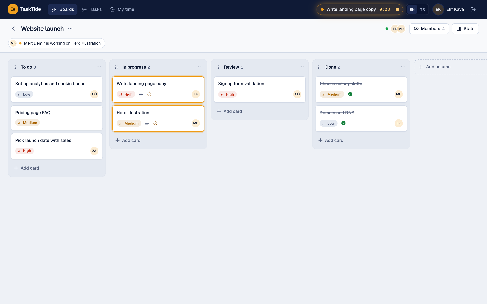
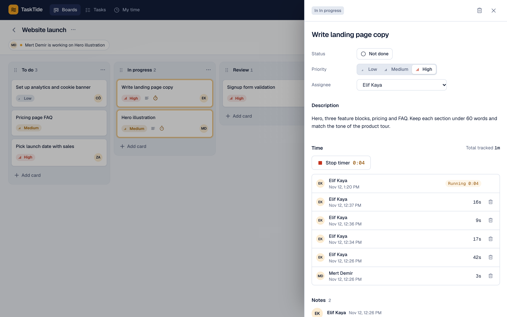
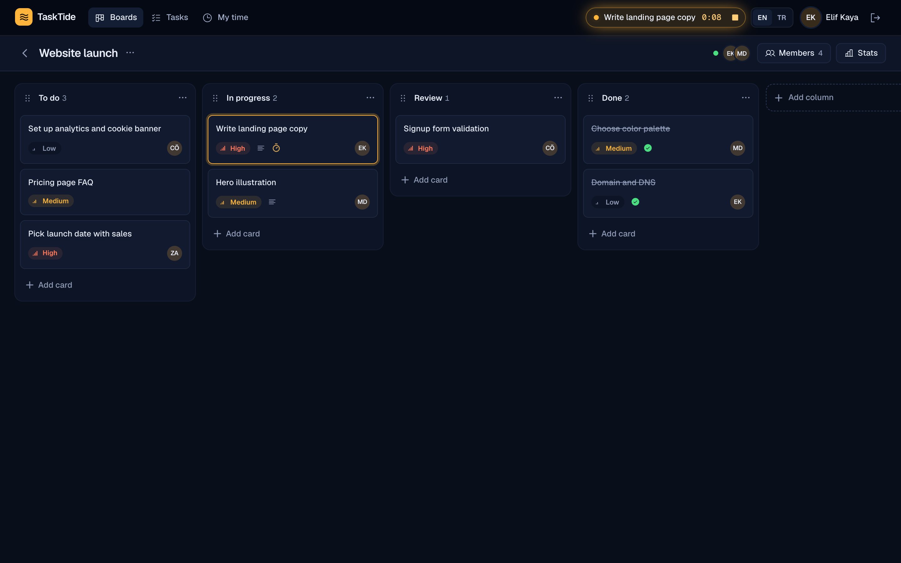
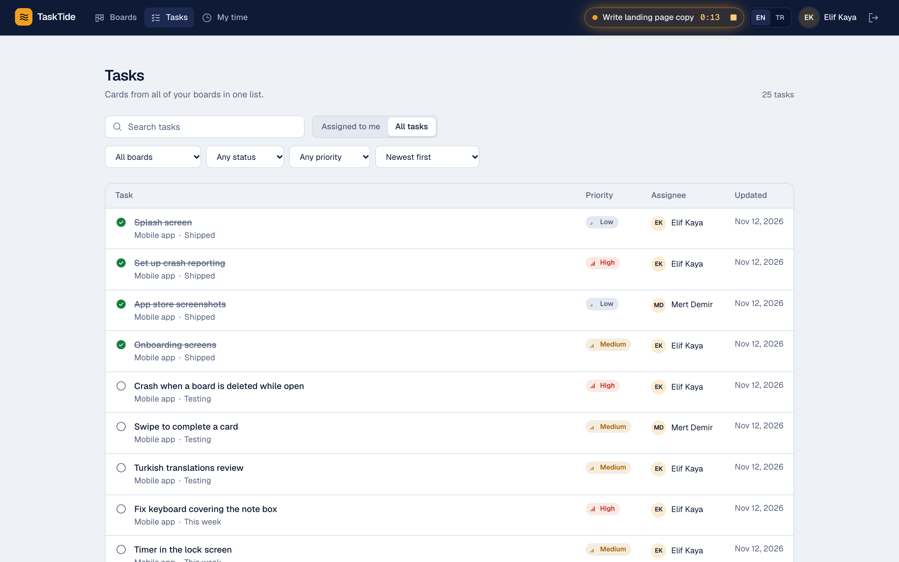
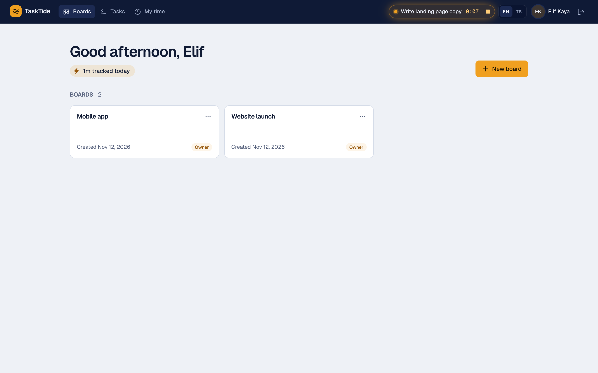
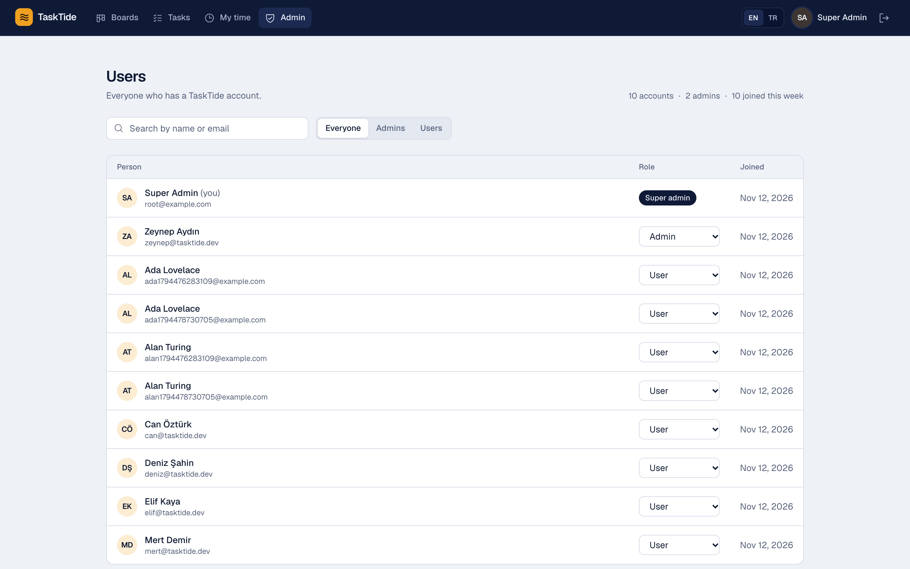
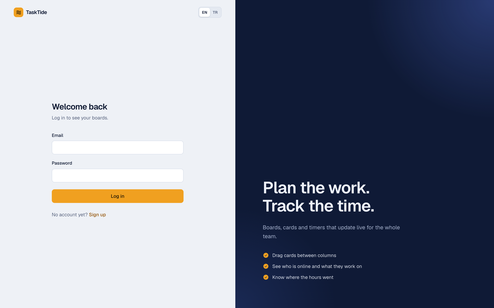
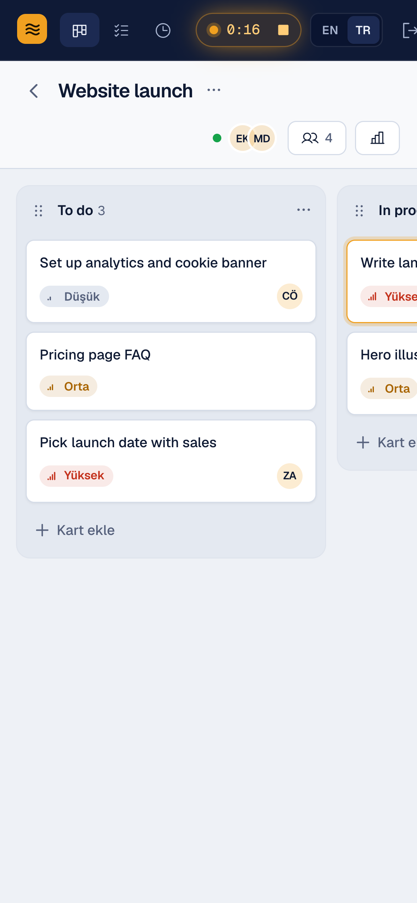

# TaskTide

Frontend for **TaskTide**, a real-time Kanban board with time tracking.
Teams create boards, invite members, drag cards between columns and track the time they spend on each card.
Every change shows up live for everyone who has the board open.

**Live:** https://tasktide.example.com · **Backend:** [orewakm/tasktide_backend](https://github.com/orewakm/tasktide_backend)

**Stack:** Next.js 16 (App Router) · React 19 · TypeScript · Tailwind CSS 4 · TanStack Query · Socket.IO client · dnd-kit · Recharts



| Card details | Dark mode |
|---|---|
|  |  |

| Task list | Board stats |
|---|---|
|  |  |

| Your boards | User management |
|---|---|
|  |  |

| Login | On a phone, in Turkish |
|---|---|
|  |  |

## Features

- **Accounts:** sign up, log in and log out. The session token is kept in `localStorage`.
- **Boards:** create, rename and delete boards. The owner invites people by email; invited users accept or decline.
- **Columns and cards:** add, rename, delete and drag and drop them. A move shows up right away and is undone if the server rejects it.
- **Card details:** title, description, priority, assignee and done state. If two people edit the same card, the second save is refused and the card reloads instead of overwriting the first person's change.
- **Notes:** the card's assignee writes progress notes; authors edit their own.
- **Task list:** every card from all your boards in one table, with search, filters (board, status, priority), sorting and pages. "Assigned to me" is the default view. The filters live in the URL, so a filtered list survives a reload and can be shared. Each task links straight to its card.
- **Time tracking:** one running timer per person, shown in the header on every page. Stats per board and per person, for the last 7, 30 or 90 days.
- **Board stats:** how many cards are done, overall and per column, priority and person, next to the time stats.
- **Live updates:** see who is online, who is working on which card, and every change as it happens.
- **Admin:** admins see every account; the super admin can make users admins.
- **English and Turkish**, light and dark mode, and it works on phones.

## How it meets the project brief

| Brief | Where |
|---|---|
| Modern JS framework that can be deployed | Next.js (App Router) + TypeScript |
| Tailwind CSS, Bootstrap 5 or pure CSS | Tailwind CSS 4 (`src/app/globals.css`) |
| `Components`, `Pages`, `Interfaces` folders | `src/components/`, `src/interfaces/`, and **`src/app/` is the pages folder** (see below) |
| Create, list, update, delete | Boards and cards: create, list, edit (rename, card details), delete. The task list adds search, filters, sorting and pages |
| LocalStorage | Session token and language choice (`src/lib/token.ts`, `src/i18n/useLanguage.ts`) |
| At least one screenshot | Above, in `docs/screenshots/` |
| Public GitHub repo | This repo |
| Deployed | Own server (VDS) with Docker and Caddy, see [Deployment](#deployment) |

**Why there is no `pages/` folder:** in Next.js a folder named `pages/` turns on the old Pages Router, which clashes with the App Router. In the App Router every `page.tsx` inside `src/app/` is a page, so `src/app/` is this project's pages folder.

## Running locally

Requirements: Node.js 24 and the [backend](https://github.com/orewakm/tasktide_backend) running on `http://localhost:8000`.

```bash
cp .env.example .env.local   # NEXT_PUBLIC_API_URL=http://localhost:8000
npm install
npm run dev                  # http://localhost:3000
```

Keep the dev server on port 3000: the backend's CORS setting allows `http://localhost:3000` by default.

### Environment variables

| Variable | Example | Description |
|---|---|---|
| `NEXT_PUBLIC_API_URL` | `http://localhost:8000` | Where the API and Socket.IO live. Leave it empty when the frontend and API share one domain (production). |

### Scripts

| Command | What it does |
|---|---|
| `npm run dev` | Development server with hot reload |
| `npm run build` / `npm start` | Production build and server |
| `npm run lint` | ESLint |
| `npm run typecheck` | Type-check without building |

## Project structure

```
src/
  app/                 pages (App Router)
    login/, register/  auth pages
    (app)/             everything behind login: shared header and login check
      boards/          board list
      boards/[id]/     a board (?card=id opens a card), and its stats in stats/
      tasks/           task list across all boards
      me/stats/        my own time
      admin/           user management
  components/          React components
    ui/                buttons, inputs, dialogs, menus, skeletons
    board/             board screen, columns, cards, card panel, live updates
    boards/            board list tiles and invitations
    stats/             charts, card summary and stats screens
    tasks/             task list: filters kept in the URL, table, pages
    admin/             user list
  interfaces/          TypeScript types for every API response and socket event
  lib/
    api/               one function per API endpoint
    socket.ts          Socket.IO connection
    queryKeys.ts       TanStack Query cache keys
  i18n/                English and Turkish text
deploy/                Docker Compose and Caddy setup for the server
```

## How it works

- **Data:** TanStack Query loads and caches everything. Pages read from the cache, and saves update it directly, so the screen changes without a reload.
- **Live updates:** while a board is open, the app joins its Socket.IO room. Each event (card moved, note added, timer started…) updates the same cache, so the change from another person looks the same as your own.
- **Drag and drop:** dnd-kit with mouse, touch and keyboard. The card moves on screen first; the request follows, and the card goes back if it fails.
- **State in the URL:** the task list's search, filters, sort and page, and the card that is open on a board, are kept in the URL query (`useSearchParams` to read, `history.replaceState` / `pushState` to write). Reloading or sharing the link shows the same view.
- **Edit conflicts:** each card has a version number. A save sends the version it started from, and if someone else saved in between, the API answers `409` and the app reloads the card.
- **Login:** the token is in `localStorage`, so only the browser knows who is logged in. Pages behind login render in the browser after the token is read; the API checks every request.

## Deployment

The app runs on a VDS with Docker. [Caddy](https://caddyserver.com) serves everything on one domain with automatic HTTPS: `/api` and `/socket.io` go to the backend, every other path goes to Next.js. Because it's one domain, `NEXT_PUBLIC_API_URL` stays empty and there are no CORS issues.

```bash
# on the server, with Docker installed and the domain's DNS pointing at it
mkdir ~/tasktide && cd ~/tasktide
git clone https://github.com/orewakm/tasktide_backend.git
git clone https://github.com/orewakm/tasktide_frontend.git
cd tasktide_frontend/deploy
cp .env.example .env         # set DOMAIN, DB_PASSWORD, SUPER_ADMIN_EMAIL, SUPER_ADMIN_PASSWORD
docker compose up -d --build
```

This starts Caddy, the frontend, the API, PostgreSQL and Redis. Only Caddy is reachable from outside (ports 80 and 443).
To update later: `git pull` in both repos, then `docker compose up -d --build` again.

The frontend image (`Dockerfile`) uses Next.js `output: 'standalone'`, so it ships only the server and the files it needs.
