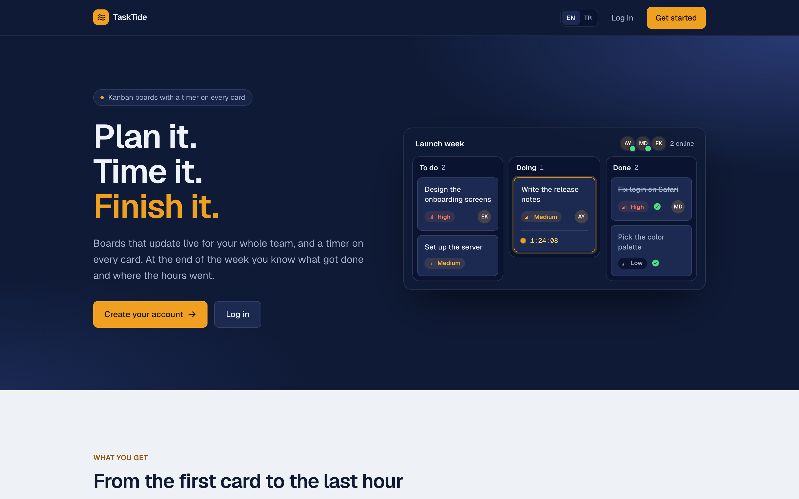
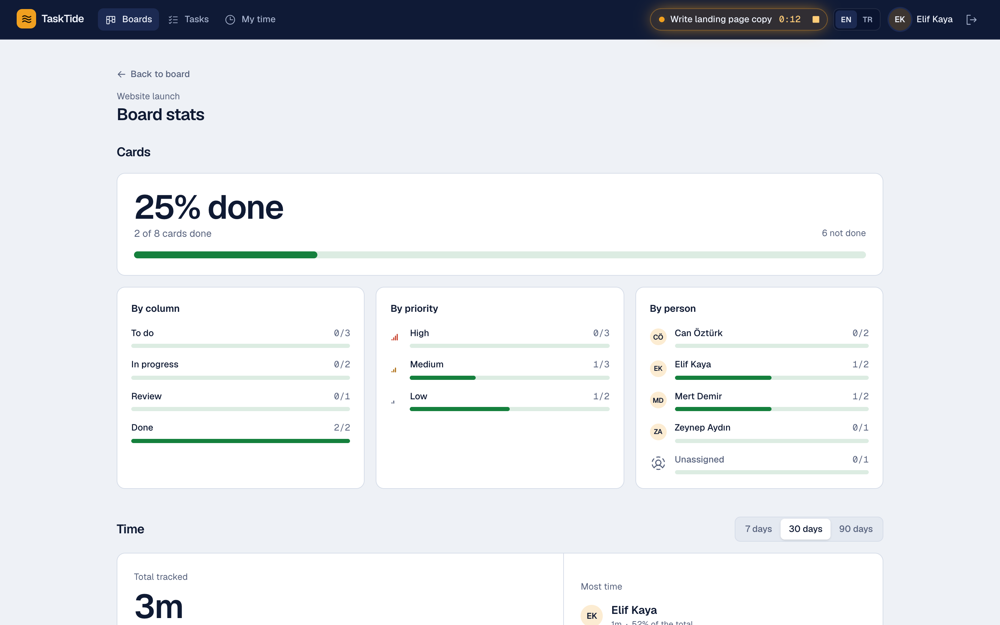

# TaskTide

Live: https://tasktide.live

Try it without an account: https://tasktide.live/demo opens a sample board with a guest account. The browser remembers that guest, so your changes are still there when you come back.

## Stack

Next.js 16 (App Router), React 19, TypeScript, Tailwind CSS 4, TanStack Query, Socket.IO client, dnd-kit, Recharts, Docker.

## Getting started

The [backend](https://github.com/orewakm/tasktide_backend) must run first (`docker compose up --build` in its repo). Then:

```bash
git clone https://github.com/orewakm/tasktide_frontend.git
cd tasktide_frontend
docker compose up --build
```

The app runs on `http://localhost:3000` and calls the API on `http://localhost:8000`. No `.env` is needed.

For development with hot reload: `npm install`, then `npm run dev`.

## What it's for

TaskTide is the frontend of a Kanban board where teams create boards, assign tasks to each other and track the time they spend on them. Every change shows up live for everyone who has the board open.

## How it works

- **Pages:** `src/app/` is the project's Pages folder. In the App Router every `page.tsx` in it is a page; a folder named `pages/` would switch Next.js to the old Pages Router.
- **Components and types:** React components are in `src/components/`, and the types for every API response and socket event are in `src/interfaces/`.
- **API calls:** `src/lib/api/` has one function per endpoint. TanStack Query caches the answers, and saves update the cache, so the screen changes without a reload.
- **Login:** the token from login is kept in `localStorage` and sent as `Authorization: Bearer <token>`.
- **Live updates:** an open board joins its Socket.IO room, and every event (card moved, note added, timer started) updates the same cache.
- **Languages:** English and Turkish, with a switch in the header. The choice is saved in `localStorage`.

## Pages

| URL | What it does |
|---|---|
| `/` | Landing page |
| `/login`, `/register` | Log in / sign up |
| `/boards` | My boards and invitations; create, rename and delete boards |
| `/boards/:id` | A board: columns and cards with drag and drop, members, and the card panel (`?card=<id>`) |
| `/boards/:id/stats` | Cards done and time tracked on a board |
| `/tasks` | Cards from all my boards with search, filters, sorting and pages |
| `/me/stats` | My own tracked time |
| `/admin` | All users; the super admin changes roles |

## Screenshots

| Landing page | Board |
|---|---|
|  |  |

| Card details | Board stats |
|---|---|
|  |  |

## Deployment

Runs on a VDS with Docker Compose and Caddy (automatic HTTPS, the app and the API on one domain), started from `deploy/` with `docker compose up -d --build`.
